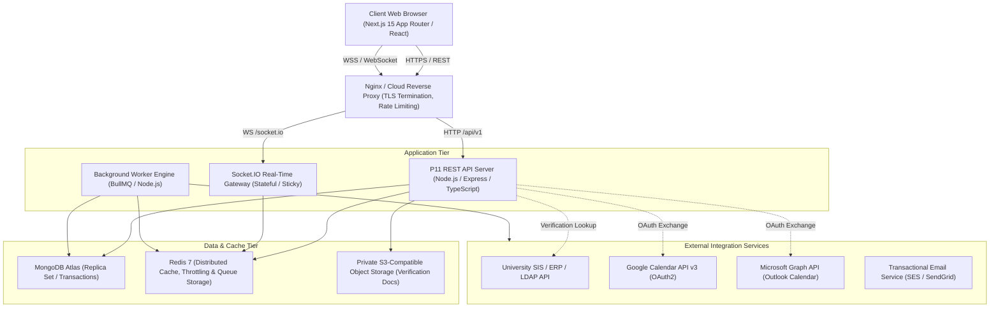

# System Architecture Document
## P11 — Verified Alumni Mentorship Matching and Engagement Platform
**Version:** 1.0.0  
**Architect:** Principal Software Architect  

---

## 1. High-Level Architectural Overview

The P11 Platform is designed as a **Modular Monorepo** separating presentation, business orchestration, and asynchronous task execution into clean, decoupled tiers while sharing data transfer objects, validation schemas, and configuration models.



---

## 2. Monorepo Organization

```
p11-platform/
├── apps/
│   ├── web/                     # Next.js 15 App Router, Tailwind, shadcn/ui, TanStack Query
│   ├── api/                     # Express.js REST API with modular domain architecture
│   └── worker/                  # BullMQ background worker engine
├── packages/
│   ├── shared/                  # Utilities, constants, date formatters, sanitizers
│   ├── validation/              # Shared Zod validation schemas for forms & endpoints
│   ├── types/                   # TypeScript interfaces, DTOs, and role definitions
│   └── config/                  # Shared environment and configuration parsers
├── infrastructure/
│   ├── docker/                  # Dockerfiles for api, web, worker
│   ├── deployment/              # Production deployment manifests & compose definitions
│   └── monitoring/              # Health check scripts, Prometheus/Grafana configs
├── docs/                        # Formal architecture, database, security, and privacy docs
├── scripts/                     # Seeders, data migration tools, ERP CSV import scripts
└── tests/                       # Integration, concurrency, privacy, and e2e test suites
```

---

## 3. Tier Responsibilities & Boundaries

### 3.1 Web Tier (`apps/web`)
- **Technology**: Next.js 15 App Router, React 19, TypeScript, Tailwind CSS, shadcn/ui.
- **State Management**: TanStack Query for server state caching and optimistic updates; React Hook Form + Zod for client-side validation.
- **Security Boundaries**: Zero direct database access. All data mutations occur via authenticated REST calls or WebSockets with CSRF and anti-tamper cookies.

### 3.2 API Tier (`apps/api`)
- **Technology**: Node.js LTS (v22), Express.js, TypeScript.
- **Layering Principle**:
  - `Routes`: Pure endpoint definitions and middleware attachment (authentication, RBAC, validation, rate limiting).
  - `Controllers`: HTTP translation, parameter extraction, and delegating to services.
  - `Services`: Core business logic, transaction management, invariant enforcement (e.g. capacity checks).
  - `Repositories / Models`: Mongoose data access layer with compound indexing, lifecycle hooks, and projection safety.
  - `Serializers (DTOs)`: Critical privacy boundary. Converts internal models to sanitized JSON structures.
- **API Versioning**: Prefix `/api/v1/` enforced across all routes.

### 3.3 Worker Tier (`apps/worker`)
- **Technology**: BullMQ on Redis.
- **Queue Responsibilities**:
  1. `request-expiry`: Evaluates pending requests older than 7 days and transitions them to `EXPIRED`.
  2. `session-reminders`: Schedules notifications 24 hours and 1 hour before booked sessions.
  3. `engagement-evaluator`: Weekly cron evaluating active mentorship health (`HEALTHY`, `AT_RISK`, `DORMANT`).
  4. `capacity-reconciler`: Daily reconciliation comparing `currentActiveMentees` counter against active `Mentorship` records to detect and auto-remedy drift.
  5. `calendar-sync`: Background synchronization with Google Calendar and Microsoft Graph.
  6. `email-dispatcher`: Transactional emails with retry policies and exponential backoff.

### 3.4 Data & Storage Tier
- **Primary Database**: MongoDB 7.0+ Replica Set. Required for multi-document ACID transactions coordinating capacity reservations, mentorship creation, and request acceptance.
- **Cache & Message Broker**: Redis 7+. High-speed distributed locks (`Redlock` pattern), rate limiting token buckets, and BullMQ queues.
- **Object Storage**: S3-compatible private bucket (MinIO for dev, AWS S3 / GCS for production) with server-side encryption and time-limited pre-signed URLs for verification documents.

---

## 4. Key Architectural Design Patterns

### 4.1 Invariant Protection: Atomic Mentor Capacity
To prevent race conditions where two students simultaneously accept a mentor with 1 remaining slot:
1. Conditional atomic update:
   ```typescript
   const updatedCapacity = await MentorCapacityModel.findOneAndUpdate(
     { mentorId, currentActiveMentees: { $lt: "$maxActiveMentees" }, isAcceptingRequests: true, isPaused: false },
     { $inc: { currentActiveMentees: 1 } },
     { new: true, session }
   );
   if (!updatedCapacity) {
     throw new BusinessRuleViolationError("Mentor has reached maximum mentee capacity.");
   }
   ```
2. When MongoDB replica set is available, this conditional increment is wrapped in a multi-document transaction along with `MentorshipRequest` state update to `ACCEPTED` and `Mentorship` record creation.
3. Every capacity change is recorded in an idempotent log.

### 4.2 Strict Privacy & Zero-Contact-Leak DTO Serialization
To ensure alumni personal email addresses, phone numbers, and private documents never leak to students:
- Controllers **never** return raw Mongoose documents.
- Every endpoint transforms entities via explicit allowlisted Serializers (`StudentViewAlumnusDTO`, `PublicAlumnusDTO`, `AdminAlumnusDTO`).
- An automated privacy test suite systematically fuzzes and inspects every student-facing response structure for regex patterns matching email addresses, phone numbers, and private URLs.

### 4.3 Modular Integration Adapters
The platform uses the **Adapter / Strategy Pattern** for external integrations:
- `IInstitutionalVerificationProvider`: Defaults to `LocalDatabaseVerificationAdapter`, with pluggable `LdapVerificationAdapter` and `CsvBatchVerificationAdapter`.
- `ICalendarProvider`: Supports `GoogleCalendarAdapter`, `MicrosoftGraphAdapter`, and `InternalFallbackCalendarAdapter`.
- `IEmailProvider`: Defaults to `ConsoleMockEmailProvider` in development and `SmtpEmailProvider` / `AwsSesEmailProvider` in production.

