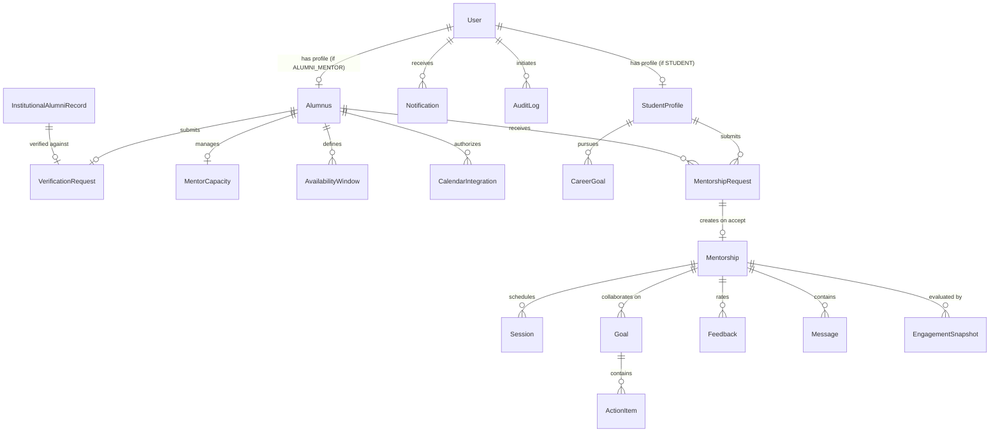

# Database Schema Design
## P11 — Verified Alumni Mentorship Platform
**Database Engine:** MongoDB 7.0+ (Replica Set enabled)  
**ODM:** Mongoose with TypeScript strict type definitions  

---

## 1. Schema Overview & Entity-Relationship Architecture

---

## 2. Model Specifications (All 24 Entities)

### 2.1 User
- `_id`: ObjectId
- `email`: String (lowercase, unique, indexed, trimmed)
- `passwordHash`: String (Argon2id)
- `firstName`: String
- `lastName`: String
- `role`: Enum [`STUDENT`, `ALUMNI_MENTOR`, `ALUMNI_RELATIONS_OFFICER`, `PLACEMENT_OFFICER`, `SUPER_ADMIN`]
- `status`: Enum [`ACTIVE`, `SUSPENDED`, `DEACTIVATED`, `PENDING_EMAIL_VERIFICATION`]
- `isEmailVerified`: Boolean (default: false)
- `emailVerificationToken`: String (hashed)
- `passwordResetToken`: String (hashed)
- `passwordResetExpires`: Date
- `mfaSecret`: String (encrypted)
- `mfaEnabled`: Boolean (default: false)
- `lastLoginAt`: Date
- `createdAt`, `updatedAt`: Date
- **Indexes**: `{ email: 1 }` (unique), `{ role: 1 }`, `{ status: 1 }`

### 2.2 Alumnus
- `_id`: ObjectId
- `userId`: ObjectId -> User (unique, ref: 'User')
- `institutionalId`: String (e.g. university roll or alumni ID)
- `graduationYear`: Number (indexed)
- `academicDepartment`: String (indexed)
- `degree`: String
- `professionalDesignation`: String
- `organisation`: String (company / institution)
- `industry`: String (indexed)
- `yearsOfExperience`: Number
- `professionalSummary`: String (max 1000 chars)
- `expertiseTags`: [String] (indexed)
- `mentoringTopics`: [String]
- `preferredStudentProfiles`: [String]
- `preferredCareerStages`: [String]
- `verificationStatus`: Enum [`NOT_SUBMITTED`, `PENDING`, `UNDER_REVIEW`, `VERIFIED`, `REJECTED`, `NEEDS_INFORMATION`, `SUSPENDED`]
- `isSearchable`: Boolean (computed: `verificationStatus === 'VERIFIED' && isAcceptingRequests && !isPaused`)
- `createdAt`, `updatedAt`: Date
- **Indexes**: `{ userId: 1 }` (unique), `{ verificationStatus: 1, isSearchable: 1 }`, `{ expertiseTags: 1 }`, `{ industry: 1 }`, `{ graduationYear: 1 }`

### 2.3 InstitutionalAlumniRecord
- `_id`: ObjectId
- `institutionalAlumniId`: String (unique, uppercase, trimmed)
- `legalFullName`: String
- `graduationYear`: Number
- `academicDepartment`: String
- `degreeAwarded`: String
- `officialEmail`: String (lowercase)
- `source`: Enum [`MANUAL_IMPORT`, `REGISTRAR_ERP_SYNC`, `CSV_BATCH`]
- `isClaimed`: Boolean (default: false)
- `claimedByUserId`: ObjectId -> User (optional)
- `createdAt`, `updatedAt`: Date
- **Indexes**: `{ institutionalAlumniId: 1 }` (unique), `{ officialEmail: 1 }`, `{ graduationYear: 1, academicDepartment: 1 }`

### 2.4 VerificationRequest
- `_id`: ObjectId
- `alumnusId`: ObjectId -> Alumnus (unique, ref: 'Alumnus')
- `userId`: ObjectId -> User
- `submittedAlumniId`: String
- `graduationYear`: Number
- `academicDepartment`: String
- `degree`: String
- `documentUrls`: [String] (private object storage paths)
- `verificationMethod`: Enum [`INSTITUTIONAL_ERP_MATCH`, `CSV_REGISTRAR_MATCH`, `MANUAL_DOCUMENT_REVIEW`]
- `institutionalRecordId`: ObjectId -> InstitutionalAlumniRecord (optional)
- `status`: Enum [`PENDING`, `UNDER_REVIEW`, `VERIFIED`, `REJECTED`, `NEEDS_INFORMATION`, `SUSPENDED`]
- `reviewedBy`: ObjectId -> User (ref: 'User', optional)
- `reviewedAt`: Date
- `rejectionReason`: String
- `reviewNotes`: String
- `auditLog`: [{
    `action`: String,
    `performedBy`: ObjectId -> User,
    `timestamp`: Date,
    `comment`: String
  }]
- `createdAt`, `updatedAt`: Date
- **Indexes**: `{ alumnusId: 1 }` (unique), `{ status: 1 }`, `{ submittedAlumniId: 1 }`

### 2.5 ExpertiseTag
- `_id`: ObjectId
- `name`: String (unique, lowercase, trimmed)
- `category`: String (e.g. 'Software Engineering', 'Finance', 'Research')
- `usageCount`: Number (default: 0)
- **Indexes**: `{ name: 1 }` (unique), `{ category: 1 }`

### 2.6 MentorCapacity
- `_id`: ObjectId
- `mentorId`: ObjectId -> Alumnus (unique, ref: 'Alumnus')
- `maxActiveMentees`: Number (min: 1, max: 10, default: 2)
- `currentActiveMentees`: Number (default: 0, min: 0)
- `isAcceptingRequests`: Boolean (default: true)
- `isPaused`: Boolean (default: false)
- `pauseReason`: String
- `lastUpdated`: Date
- **Indexes**: `{ mentorId: 1 }` (unique), `{ isAcceptingRequests: 1, isPaused: 1 }`

### 2.7 AvailabilityWindow
- `_id`: ObjectId
- `mentorId`: ObjectId -> Alumnus (ref: 'Alumnus')
- `dayOfWeek`: Number (0 = Sunday, 6 = Saturday)
- `startTimeUTC`: String (HH:mm format)
- `endTimeUTC`: String (HH:mm format)
- `mentorTimeZone`: String (IANA string, e.g. 'Asia/Kolkata', 'America/New_York')
- `sessionDurationMinutes`: Number (default: 45)
- `minNoticeHours`: Number (default: 24)
- `maxAdvanceDays`: Number (default: 30)
- `isRecurring`: Boolean (default: true)
- `blackoutDates`: [Date]
- **Indexes**: `{ mentorId: 1, dayOfWeek: 1 }`

### 2.8 StudentProfile
- `_id`: ObjectId
- `userId`: ObjectId -> User (unique, ref: 'User')
- `institutionalStudentId`: String (unique)
- `academicProgramme`: String (e.g. 'B.Tech', 'M.S.')
- `department`: String (indexed)
- `expectedGraduationYear`: Number (indexed)
- `skills`: [String] (indexed)
- `targetJobRoles`: [String] (indexed)
- `preferredIndustries`: [String]
- `preferredCommunicationFrequency`: Enum [`WEEKLY`, `BIWEEKLY`, `MONTHLY`]
- `timeZone`: String (default: 'UTC')
- `profileCompletionScore`: Number (0-100)
- `createdAt`, `updatedAt`: Date
- **Indexes**: `{ userId: 1 }` (unique), `{ department: 1, expectedGraduationYear: 1 }`

### 2.9 CareerGoal
- `_id`: ObjectId
- `studentId`: ObjectId -> StudentProfile (ref: 'StudentProfile')
- `title`: String
- `description`: String
- `targetRole`: String
- `targetIndustry`: String
- `targetCompletionDate`: Date
- `isPrimary`: Boolean (default: false)
- `status`: Enum [`IN_PROGRESS`, `ACHIEVED`, `PAUSED`, `ABANDONED`]
- **Indexes**: `{ studentId: 1 }`

### 2.10 MatchScore
- `_id`: ObjectId
- `studentId`: ObjectId -> StudentProfile
- `mentorId`: ObjectId -> Alumnus
- `overallScore`: Number (0 - 100)
- `breakdown`: {
    `expertiseScore`: Number,
    `roleScore`: Number,
    `industryScore`: Number,
    `mentoringInterestScore`: Number,
    `availabilityScore`: Number
  }
- `explanation`: {
    `matchingSkills`: [String],
    `matchingRoles`: [String],
    `matchingIndustries`: [String],
    `hasAvailabilityOverlap`: Boolean
  }
- `algorithmVersion`: String
- `calculatedAt`: Date
- **Indexes**: `{ studentId: 1, mentorId: 1 }` (unique), `{ overallScore: -1 }`

### 2.11 MentorshipRequest
- `_id`: ObjectId
- `studentId`: ObjectId -> StudentProfile (ref: 'StudentProfile')
- `mentorId`: ObjectId -> Alumnus (ref: 'Alumnus')
- `careerObjective`: String
- `requestMessage`: String
- `preferredTopics`: [String]
- `expectedOutcomes`: String
- `preferredAvailability`: String
- `status`: Enum [`PENDING`, `ACCEPTED`, `DECLINED`, `EXPIRED`, `CANCELLED`]
- `idempotencyKey`: String (unique)
- `declineReason`: String (optional)
- `respondedAt`: Date
- `expiresAt`: Date (created + 7 days)
- `createdAt`, `updatedAt`: Date
- **Indexes**: `{ studentId: 1, status: 1 }`, `{ mentorId: 1, status: 1 }`, `{ idempotencyKey: 1 }` (unique), `{ expiresAt: 1 }`

### 2.12 Mentorship
- `_id`: ObjectId
- `studentId`: ObjectId -> StudentProfile (ref: 'StudentProfile')
- `mentorId`: ObjectId -> Alumnus (ref: 'Alumnus')
- `requestId`: ObjectId -> MentorshipRequest (unique, ref: 'MentorshipRequest')
- `status`: Enum [`ACTIVE`, `COMPLETED`, `PAUSED`, `TERMINATED`]
- `startDate`: Date
- `endDate`: Date
- `healthStatus`: Enum [`HEALTHY`, `AT_RISK`, `DORMANT`]
- `lastMeaningfulActivityAt`: Date
- `totalSessionsCompleted`: Number (default: 0)
- `closureReason`: String
- `createdAt`, `updatedAt`: Date
- **Indexes**: `{ studentId: 1, status: 1 }`, `{ mentorId: 1, status: 1 }`, `{ healthStatus: 1 }`

### 2.13 Session
- `_id`: ObjectId
- `mentorshipId`: ObjectId -> Mentorship (ref: 'Mentorship')
- `scheduledStartTime`: Date (UTC)
- `scheduledEndTime`: Date (UTC)
- `timeZone`: String
- `status`: Enum [`PROPOSED`, `CONFIRMED`, `COMPLETED`, `CANCELLED`, `RESCHEDULED`]
- `proposedBy`: ObjectId -> User
- `meetingLink`: String (e.g. Google Meet, Teams, or Platform internal)
- `externalCalendarEventId`: String (optional)
- `calendarProvider`: Enum [`GOOGLE`, `OUTLOOK`, `NONE`]
- `agenda`: String
- `mentorNotes`: String (private to mentor)
- `sharedNotes`: String
- `cancellationReason`: String
- `createdAt`, `updatedAt`: Date
- **Indexes**: `{ mentorshipId: 1, scheduledStartTime: 1 }`, `{ status: 1, scheduledStartTime: 1 }`

### 2.14 Goal
- `_id`: ObjectId
- `mentorshipId`: ObjectId -> Mentorship (ref: 'Mentorship')
- `title`: String
- `description`: String
- `category`: Enum [`TECHNICAL_SKILLS`, `CAREER_STRATEGY`, `INTERVIEW_PREP`, `NETWORKING`, `PORTFOLIO_REVIEW`]
- `targetDate`: Date
- `progressPercentage`: Number (0-100, default: 0)
- `status`: Enum [`IN_PROGRESS`, `COMPLETED`, `ABANDONED`]
- `createdBy`: ObjectId -> User
- `completedAt`: Date
- `createdAt`, `updatedAt`: Date
- **Indexes**: `{ mentorshipId: 1, status: 1 }`

### 2.15 ActionItem
- `_id`: ObjectId
- `goalId`: ObjectId -> Goal (ref: 'Goal')
- `mentorshipId`: ObjectId -> Mentorship
- `description`: String
- `assignedTo`: ObjectId -> User
- `dueDate`: Date
- `priority`: Enum [`LOW`, `MEDIUM`, `HIGH`, `URGENT`]
- `isCompleted`: Boolean (default: false)
- `completedAt`: Date
- `createdAt`, `updatedAt`: Date
- **Indexes**: `{ goalId: 1 }`, `{ mentorshipId: 1, isCompleted: 1 }`

### 2.16 Feedback
- `_id`: ObjectId
- `mentorshipId`: ObjectId -> Mentorship
- `sessionId`: ObjectId -> Session (optional)
- `submittedBy`: ObjectId -> User
- `recipientRole`: Enum [`MENTOR`, `STUDENT`]
- `satisfactionRating`: Number (1-5)
- `usefulnessScore`: Number (1-5)
- `communicationQuality`: Number (1-5)
- `textFeedback`: String
- `isAnonymousToRecipient`: Boolean (default: false)
- `createdAt`: Date
- **Indexes**: `{ mentorshipId: 1 }`, `{ submittedBy: 1 }`

### 2.17 Message
- `_id`: ObjectId
- `mentorshipId`: ObjectId -> Mentorship (ref: 'Mentorship')
- `senderId`: ObjectId -> User
- `content`: String (PII sanitized/masked)
- `originalContentHashed`: String
- `piiDetected`: Boolean (default: false)
- `piiTypesDetected`: [String]
- `readBy`: [{
    `userId`: ObjectId -> User,
    `readAt`: Date
  }]
- `createdAt`: Date
- **Indexes**: `{ mentorshipId: 1, createdAt: 1 }`

### 2.18 EngagementSnapshot
- `_id`: ObjectId
- `mentorshipId`: ObjectId -> Mentorship (ref: 'Mentorship')
- `calculatedAt`: Date
- `healthStatus`: Enum [`HEALTHY`, `AT_RISK`, `DORMANT`]
- `daysSinceLastActivity`: Number
- `pendingActionItemsCount`: Number
- `completedSessionsCount`: Number
- `lastSessionDate`: Date
- `flaggedForOfficerReview`: Boolean (default: false)
- **Indexes**: `{ mentorshipId: 1, calculatedAt: -1 }`, `{ flaggedForOfficerReview: 1 }`

### 2.19 Notification
- `_id`: ObjectId
- `userId`: ObjectId -> User (ref: 'User')
- `type`: Enum [`REQUEST_RECEIVED`, `REQUEST_ACCEPTED`, `REQUEST_DECLINED`, `SESSION_PROPOSED`, `SESSION_CONFIRMED`, `SESSION_REMINDER`, `NEW_MESSAGE`, `ACTION_ITEM_DUE`, `VERIFICATION_UPDATE`]
- `title`: String
- `message`: String
- `referenceId`: String
- `referenceType`: String
- `isRead`: Boolean (default: false)
- `readAt`: Date
- `createdAt`: Date
- **Indexes**: `{ userId: 1, isRead: 1, createdAt: -1 }`

### 2.20 AuditLog
- `_id`: ObjectId
- `actorId`: ObjectId -> User (optional, null for system)
- `actorRole`: String
- `action`: String (e.g. `ALUMNI_VERIFIED`, `CAPACITY_RESERVED`, `ROLE_UPDATED`)
- `entityType`: String
- `entityId`: String
- `ipAddress`: String
- `userAgent`: String
- `metadata`: Schema.Types.Mixed
- `timestamp`: Date (default: Date.now)
- **Indexes**: `{ actorId: 1, timestamp: -1 }`, `{ entityType: 1, entityId: 1 }`, `{ action: 1 }`

### 2.21 ProgrammeSettings
- `_id`: ObjectId
- `matchingWeights`: {
    `expertiseWeight`: Number (default: 40),
    `roleWeight`: Number (default: 20),
    `industryWeight`: Number (default: 15),
    `mentoringInterestWeight`: Number (default: 10),
    `availabilityWeight`: Number (default: 15)
  }
- `requestLimits`: {
    `maxPendingRequestsPerStudent`: Number (default: 3),
    `maxRequestsPerRollingPeriod`: Number (default: 5),
    `rollingPeriodDays`: Number (default: 7),
    `requestExpiryDays`: Number (default: 7)
  }
- `engagementThresholds`: {
    `atRiskDays`: Number (default: 14),
    `dormantDays`: Number (default: 28)
  }
- `updatedBy`: ObjectId -> User
- `version`: Number (default: 1)
- `createdAt`, `updatedAt`: Date

### 2.22 RequestThrottleCounter
- `_id`: ObjectId
- `studentId`: ObjectId -> StudentProfile
- `windowStart`: Date
- `requestCount`: Number
- `expiresAt`: Date
- **Indexes**: `{ studentId: 1 }`, `{ expiresAt: 1 }` (TTL index)

### 2.23 CalendarIntegration
- `_id`: ObjectId
- `userId`: ObjectId -> User (ref: 'User')
- `provider`: Enum [`GOOGLE`, `OUTLOOK`]
- `encryptedAccessToken`: String
- `encryptedRefreshToken`: String
- `tokenExpiry`: Date
- `calendarId`: String
- `isConnected`: Boolean (default: true)
- `lastSyncAt`: Date
- `createdAt`, `updatedAt`: Date
- **Indexes**: `{ userId: 1, provider: 1 }` (unique)

### 2.24 IdempotencyRecord
- `_id`: ObjectId
- `key`: String (unique)
- `userId`: ObjectId -> User
- `endpoint`: String
- `requestPayloadHash`: String
- `responseStatus`: Number
- `responseBody`: Schema.Types.Mixed
- `createdAt`: Date
- `expiresAt`: Date
- **Indexes**: `{ key: 1 }` (unique), `{ expiresAt: 1 }` (TTL index)

