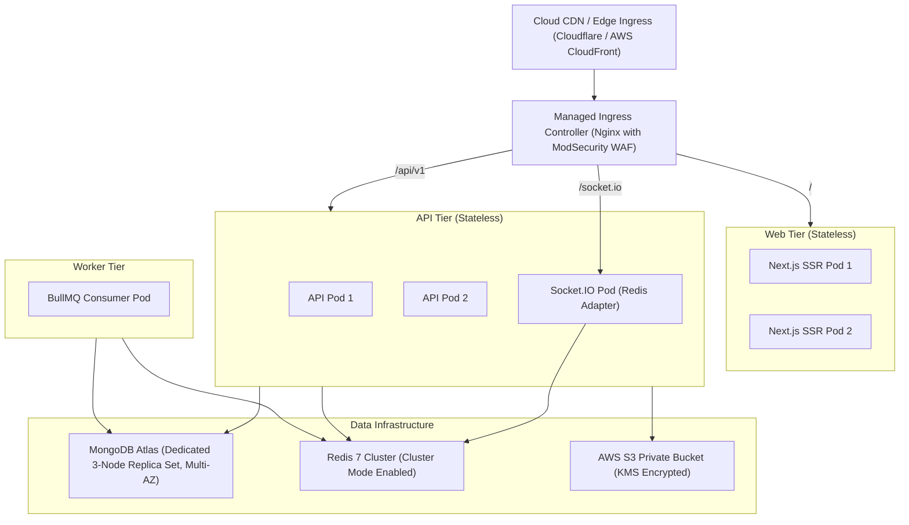

# Production Deployment & Operational Strategy
## P11 — Verified Alumni Mentorship Platform
**Version:** 1.0.0  

---

## 1. Release Architecture & Topology

---

## 2. Release Gates & Production Checklist

1. **Gate 1: Verification Integrity**: Registrar CSV batch import verified and tested against sample university test batches.
2. **Gate 2: Capacity Concurrency**: Zero race condition failures under 50 concurrent simulated request acceptances.
3. **Gate 3: Privacy Verification**: Automated PII crawler returns 0 leaks across all student endpoints.
4. **Gate 4: Secrets Management**: All keys (`JWT_SECRET`, `COOKIE_SECRET`, `CALENDAR_ENCRYPTION_KEY`, DB URIs) populated from HashiCorp Vault or AWS Secrets Manager.
5. **Gate 5: Disaster Recovery**: Automated daily MongoDB Atlas snapshots with 35-day point-in-time recovery (PITR) verified.
6. **Gate 6: Zero Downtime Deployment**: Rolling updates with health checks (`/health/liveness` and `/health/readiness`).

