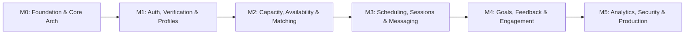

# Development Roadmap & Requirements Assessment
## P11 — Verified Alumni Mentorship Platform
**Version:** 1.0.0  

---

## 1. Requirements Assessment: Confirmed vs Assumptions

### 1.1 Confirmed Requirements (From Specification)
- Monorepo structure with Next.js App Router, Express, TypeScript, Mongoose, Redis, and BullMQ.
- 5 User Roles: `STUDENT`, `ALUMNI_MENTOR`, `ALUMNI_RELATIONS_OFFICER`, `PLACEMENT_OFFICER`, `SUPER_ADMIN`.
- Mandatory institutional verification workflow with 3 sources (ERP, CSV, Document Review).
- Atomic mentor capacity constraint as an unbreakable database invariant.
- Explainable matching engine with configurable weights (40% expertise, 20% role, 15% industry, 10% interest, 15% availability).
- Throttling: max 3 pending requests, max 5 in 7 days, 7-day auto-expiry.
- Zero-leak privacy rule: alumni email and phone numbers must never appear in student-facing responses.
- In-platform messaging with PII screening and room-level authorization.
- Full milestone execution gating (M0 $\to$ M5).

### 1.2 Identified Assumptions & Defaults
- **Institutional ERP**: Assumed standard REST/SQL or LDAP schema for institutional records. In M0/M1, an internal repository adapter backed by the `InstitutionalAlumniRecord` collection is implemented, allowing instant CSV batch uploads and ERP simulation.
- **Calendar Integrations**: Google Calendar and Microsoft Graph require production OAuth client credentials approved by institutional IT. The system implements a complete mockable adapter interface (`ICalendarProvider`) that functions internally in development and seamlessly switches to live Google/Graph OAuth when keys are supplied.
- **Object Storage**: AWS S3 or MinIO S3-compatible storage. In local dev, a local secure file storage adapter with presigned route handlers is utilized until production S3 credentials are configured.
- **Video Conferencing**: Supports internal meeting links or user-provided Google Meet / Teams links generated via session scheduling.

### 1.3 Missing Institutional Information & Integration Dependencies
1. **Institutional Single Sign-On (SSO)**: OIDC/SAML endpoints and tenant IDs from university IT.
2. **Registrar ERP Database Credentials**: Read-only connection string or scheduled SFTP dump format for student and alumni registries.
3. **Google Workspace / Microsoft 365 Tenant Approval**: Admin consent for domain-wide calendar delegation or app verification.
4. **Institutional Data Protection Officer (DPO) Approval**: Final sign-off on the Data Visibility Matrix and Data Retention policies.

---

## 2. Milestone Execution Roadmap

- **M0 — Architecture & Engineering Foundation**: Monorepo setup, shared packages, error handling, Docker environment, database connection, seeders.
- **M1 — Authentication, Authorization, Institutional Verification & Profiles**: Complete user models, Argon2id hashing, session cookies, RBAC, 3-source alumni verification, student & mentor profiles, strict DTO privacy serializers. *(Current Target)*
- **M2 — Capacity, Availability, Matching & Requests**: Atomic capacity locks, transactions, recurring availability, weighted matching engine with explanations, request throttling & expiry. *(Requires user approval `CONTINUE M2`)*
- **M3 — Scheduling, Sessions, Integrations & Messaging**: Session proposal/rescheduling, calendar sync adapter, Socket.IO authenticated messaging, PII filtering. *(Requires `CONTINUE M3`)*
- **M4 — Goals, Action Items, Feedback & Engagement Monitoring**: Shared goals, action checklist, 2-way feedback, weekly engagement evaluator, health classification. *(Requires `CONTINUE M4`)*
- **M5 — Analytics, Security Validation, Performance Testing & Production**: Placement outcome aggregations, concurrency race testing, security audits, Docker orchestration, production release gates. *(Requires `CONTINUE M5`)*

